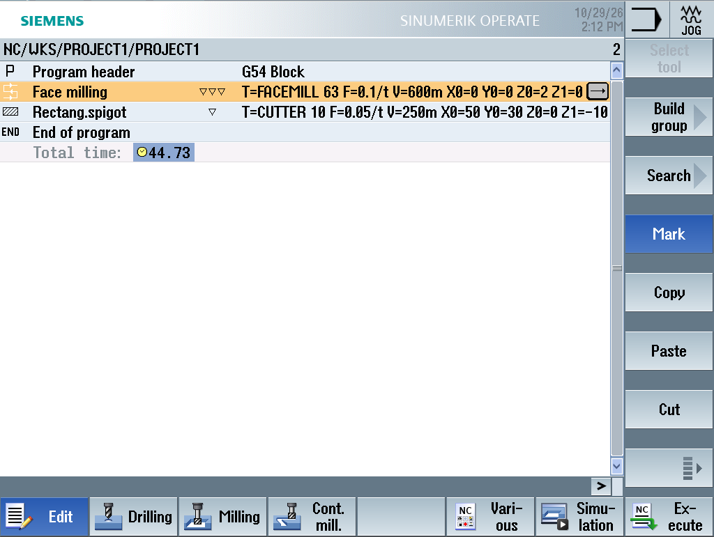
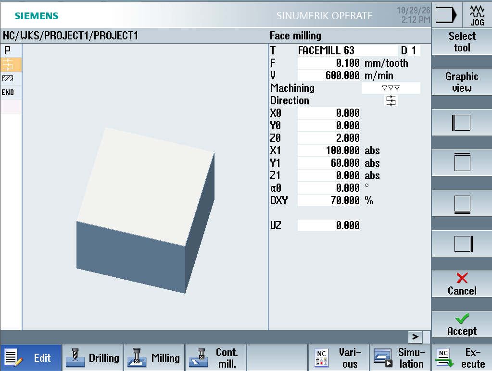
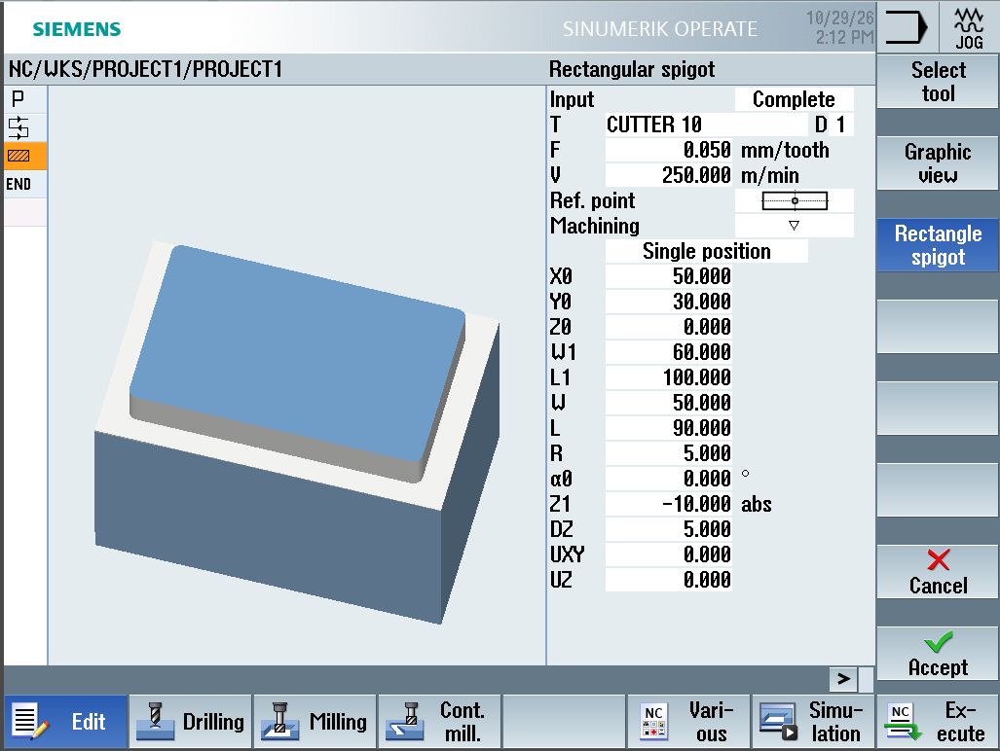
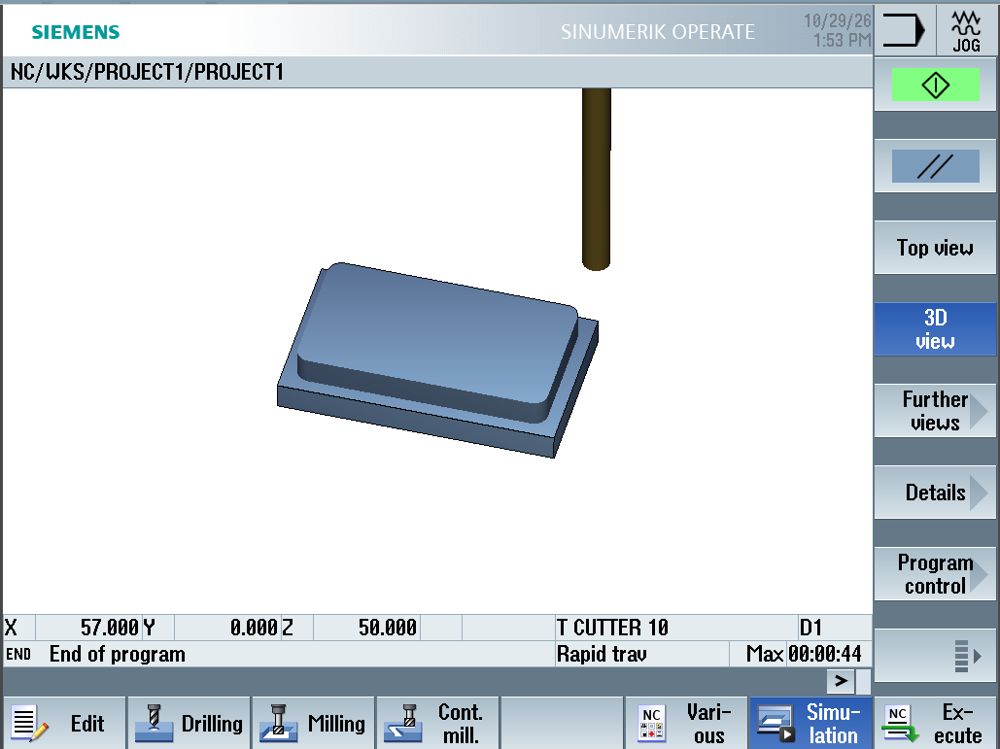
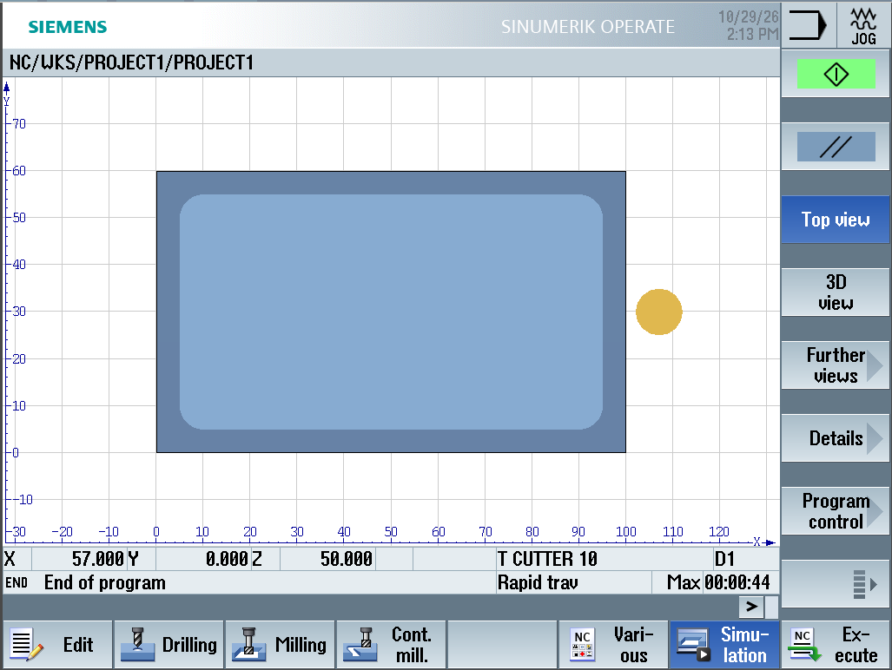

# Projekti 1 – Alumiinilevy: tasojyrsintä ja muotojyrsintä

Harjoitusprojekti, jossa ohjelmoin yksinkertaisen alumiinikappaleen Siemens SINUMERIK Operate -ohjauksella (ShopMill) ja testasin ohjelman SinuTrain-simulaatio-ohjelmistossa.

> **Huom:** Projekti on tehty simulaatiossa (SinuTrain), ei oikealla koneella.

## Kappale

| | |
|---|---|
| **Aihio** | 100 × 60 × 22 mm, alumiini |
| **Valmis kappale** | 100 × 60 × 20 mm levy, jonka päällä 90 × 50 × 10 mm suorakaiteen muotoinen kohouma, nurkkapyöristys R5 |
| **Ohjaus** | Siemens SINUMERIK Operate (840D sl), ShopMill-ohjelmointi |
| **Kone** | 3-akselinen pystykoneistuskeskus (simulaatio) |
| **Koneistusaika** | n. 45 s (simulaation mukaan) |

## Kiinnitys ja nollapiste

- **Kiinnitys:** ruuvipuristin ja alustapalat (simulaatiossa oletettu)
- **Nollapiste G54:** aihion vasen etukulma
- **Z0:** tasojyrsitty yläpinta (aihion alkuperäinen yläpinta on Z+2)

## Työkalut ja lastuamisarvot

| Työkalu | Tyyppi | Ø | Terät | Vc | fz | n (laskettu) | Syöttö vf |
|---|---|---|---|---|---|---|---|
| FACEMILL 63 | Tasojyrsin | 63 mm | 6 | 600 m/min | 0,10 mm/hammas | ≈ 3 030 1/min | ≈ 1 820 mm/min |
| CUTTER 10 | Varsijyrsin | 10 mm | 4 | 250 m/min | 0,05 mm/hammas | ≈ 7 960 1/min | ≈ 1 590 mm/min |

Laskentakaavat: `n = Vc × 1000 / (π × D)` ja `vf = n × z × fz`

## Työvaiheet

1. **Ohjelman otsikko (Program header)**
   Aihio 100 × 60 mm, ZA = 2, ZI = −20, vetäytymistaso RP = 50 mm, turvaetäisyys SC = 2 mm, myötäjyrsintä.
2. **Tasojyrsintä (Face milling)**
   FACEMILL 63, viimeistely, 2 mm yhdellä lastulla, edestakainen rata, sivuaskel 70 % työkalun halkaisijasta.
3. **Suorakaidetappi (Rectangular spigot)**
   CUTTER 10, rouhinta, 90 × 50 mm, nurkkasäde R5, syvyys 10 mm kahdella 5 mm:n lastulla.

## Kuvat

### Ohjelma

### Tasojyrsinnän parametrit

### Suorakaidetapin parametrit

### Simulaatio – 3D-näkymä

### Simulaatio – yläkuva
Mitat voi tarkistaa ruudukosta: levy X 0–100 / Y 0–60, kohouma 5 mm reunoista.

## Video

[▶ Ohjelman ajo SinuTrainissa (MP4)](imgs/Screen%20Recording%202026-10-29%20142921.mp4)

## Mitä opin

- **Työkalun nimen on vastattava työkalulistaa täsmälleen.** Ohjelmassa oli `FACEMILL63`, työkalulistassa `FACEMILL 63`, joten simulaatio ei käynnistynyt. Ratkaisu: valitsen työkalun aina listasta (*Select tool*) enkä kirjoita nimeä käsin.
- **Mittojen suunnat on tarkistettava.** Suorakaidetapissa L on X-suunnan ja W Y-suunnan mitta. Ensimmäisellä kerralla ne olivat väärin päin, ja virhe näkyi heti esikatselukuvasta.
- **NC Stop / "Axis enable missing":** akselit eivät liikkuneet, koska syöttölupa (*Feed Start*) puuttui.
- **Turvallinen ensiajo:** uusi ohjelma ajetaan ensin yksittäislausetilassa (*Single Block*) ja pienellä syötön ohituksella.
