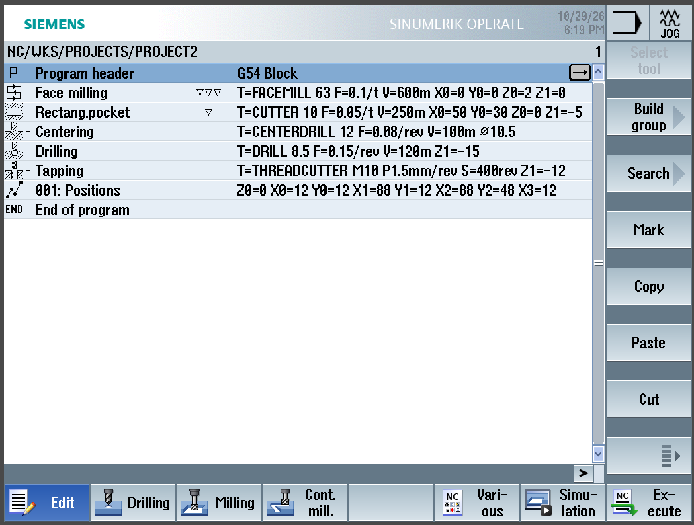
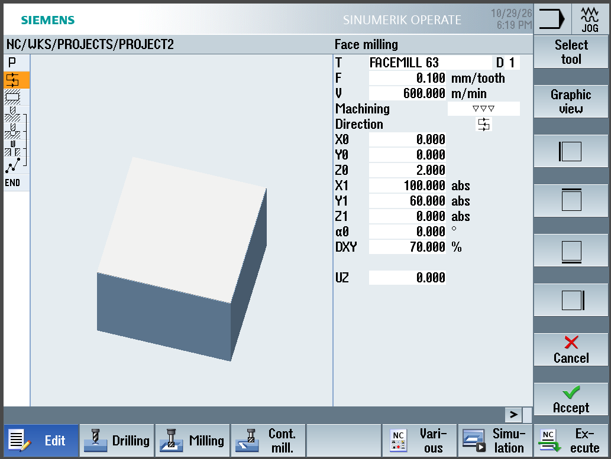
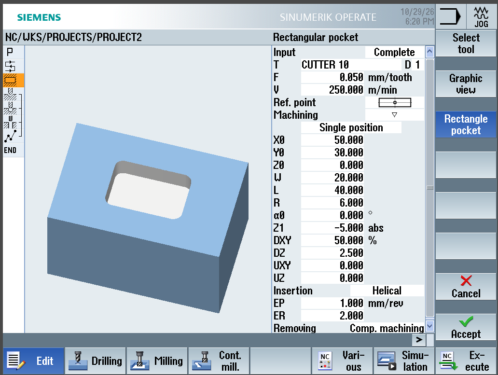
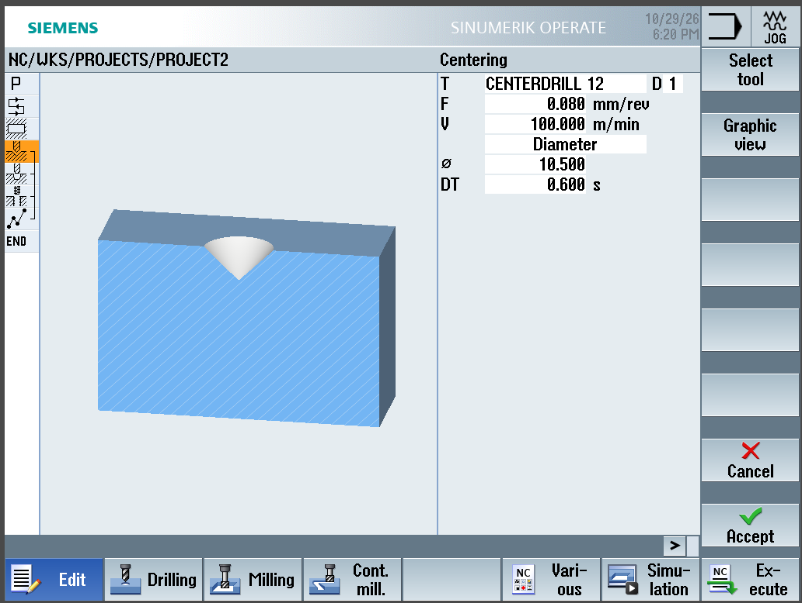
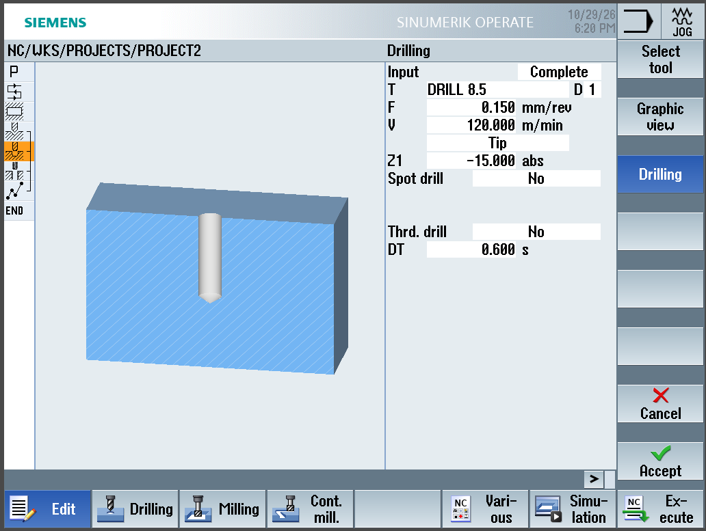
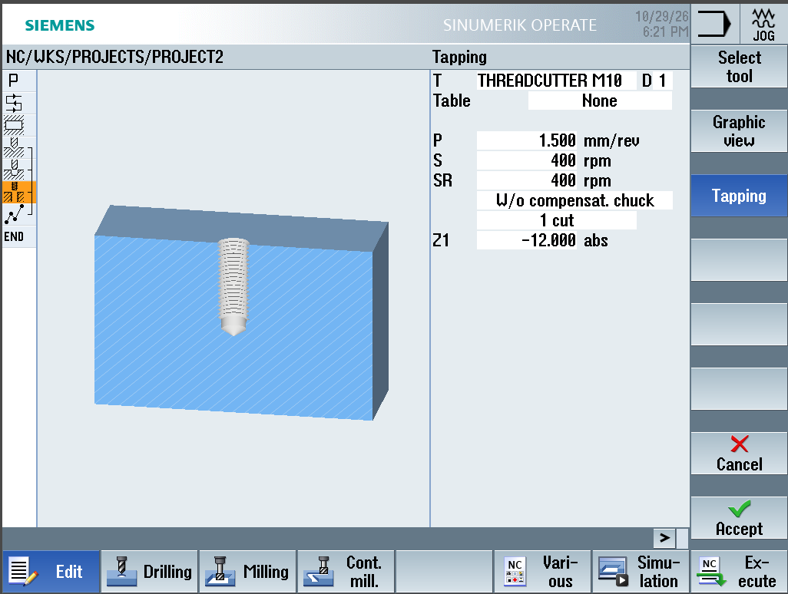
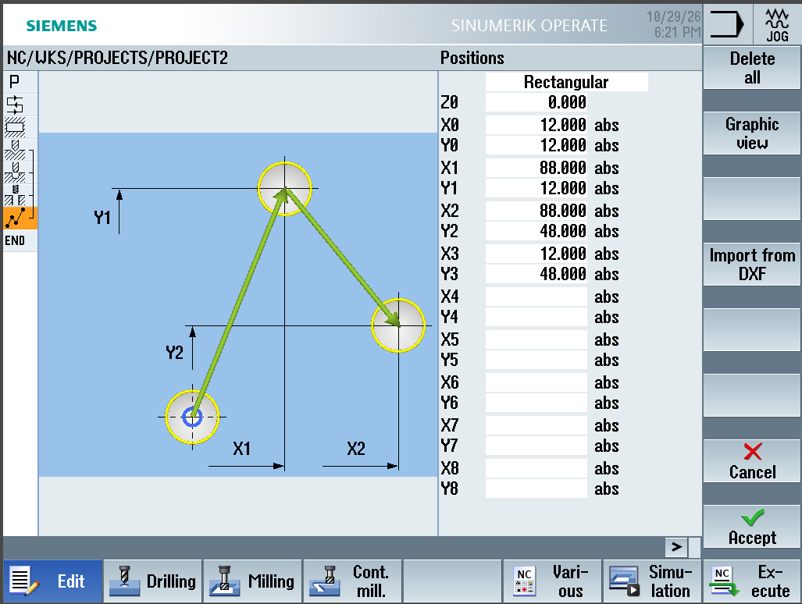

# Projekti 2 – Alumiinilevy: tasku ja kierrereiät

Harjoitusprojekti, jossa ohjelmoin alumiinikappaleen, jossa on suorakaidetasku ja neljä M10-kierrereikää. Ohjelmointi tehtiin Siemens SINUMERIK Operate -ohjauksella (ShopMill) ja ohjelma testattiin SinuTrain-simulaatio-ohjelmistossa.

Projektin tavoitteena oli harjoitella useamman työkalun käyttöä ja reikien oikeaa työjärjestystä: **keskiöinti → poraus → kierteitys**.

> **Huom:** Projekti on tehty simulaatiossa (SinuTrain), ei oikealla koneella.

## Kappale

| | |
|---|---|
| **Aihio** | 100 × 60 × 22 mm, alumiini |
| **Valmis kappale** | 100 × 60 × 20 mm levy |
| **Tasku** | 40 × 20 mm, syvyys 5 mm, nurkkasäde R6, kappaleen keskellä |
| **Reiät** | 4 × M10 × 1,5, kierteen syvyys 12 mm, 12 mm reunoista |
| **Ohjaus** | Siemens SINUMERIK Operate (840D sl), ShopMill-ohjelmointi |
| **Kone** | 3-akselinen pystykoneistuskeskus (simulaatio) |
| **Koneistusaika** | n. 1 min 27 s (simulaation mukaan) |

## Kiinnitys ja nollapiste

- **Kiinnitys:** ruuvipuristin ja alustapalat (simulaatiossa oletettu)
- **Nollapiste G54:** aihion vasen etukulma
- **Z0:** tasojyrsitty yläpinta (aihion alkuperäinen yläpinta on Z+2)

## Reikien paikat (G54)

| Reikä | X | Y |
|---|---|---|
| 1 | 12 | 12 |
| 2 | 88 | 12 |
| 3 | 88 | 48 |
| 4 | 12 | 48 |

## Työkalut ja lastuamisarvot

| Työkalu | Tyyppi | Ø | Vc | Syöttö | n | vf (laskettu) |
|---|---|---|---|---|---|---|
| FACEMILL 63 | Tasojyrsin, 6 terää | 63 mm | 600 m/min | 0,10 mm/hammas | ≈ 3 030 1/min | ≈ 1 820 mm/min |
| CUTTER 10 | Varsijyrsin, 4 terää | 10 mm | 250 m/min | 0,05 mm/hammas | ≈ 7 960 1/min | ≈ 1 590 mm/min |
| CENTERDRILL 12 | Keskiöpora 90° | 12 mm | 100 m/min | 0,08 mm/kierros | ≈ 2 650 1/min | ≈ 210 mm/min |
| DRILL 8.5 | Pora (M10:n esiporaus) | 8,5 mm | 120 m/min | 0,15 mm/kierros | ≈ 4 490 1/min | ≈ 670 mm/min |
| THREADCUTTER M10 | Kierretappi | M10 × 1,5 | ≈ 12,6 m/min | 1,5 mm/kierros (nousu) | 400 1/min | 600 mm/min |

Laskentakaavat:
- Jyrsintä: `n = Vc × 1000 / (π × D)` ja `vf = n × z × fz`
- Poraus ja kierteitys: `vf = n × f`
- M10-kierteen esiporaus: `10 − 1,5 = 8,5 mm`

## Työvaiheet

1. **Ohjelman otsikko (Program header)**
   Aihio 100 × 60 mm, ZA = 2, ZI = −20, vetäytymistaso RP = 50 mm, turvaetäisyys SC = 2 mm, myötäjyrsintä.
2. **Tasojyrsintä (Face milling)**
   FACEMILL 63, viimeistely, 2 mm yhdellä lastulla, sivuaskel 70 %.
3. **Suorakaidetasku (Rectangular pocket)**
   CUTTER 10, rouhinta, 40 × 20 mm, R6, syvyys 5 mm kahdella 2,5 mm:n lastulla. Sisäänmeno kierukkana (EP = 1 mm/kierros, ER = 2 mm), sivuaskel 50 %.
4. **Keskiöinti (Centering)**
   CENTERDRILL 12, keskiöhalkaisija Ø 10,5 mm. Keskiö toimii porauksen ohjaimena ja jättää reiän suulle viisteen, joka helpottaa kierteityksen aloitusta.
5. **Poraus (Drilling)**
   DRILL 8.5, syvyys 15 mm (kärjestä mitattuna), umpireikä.
6. **Kierteitys (Tapping)**
   THREADCUTTER M10, nousu 1,5 mm, 400 1/min, kierteen syvyys 12 mm, jäykkä kierteitys (ilman tasausistukkaa), paluukierrosluku 400 1/min.
7. **Paikat (Positions)**
   Vaiheet 4–6 on linkitetty samaan paikkakuvioon. Kone tekee ensin kaikki neljä keskiötä, sitten kaikki neljä porausta ja lopuksi kaikki neljä kierrettä, joten työkalunvaihtoja tarvitaan mahdollisimman vähän.

## Kuvat

### Ohjelma

### Tasojyrsinnän parametrit

### Taskun parametrit

### Keskiöinnin parametrit

### Porauksen parametrit

### Kierteityksen parametrit

### Reikien paikat

### Simulaatio – 3D-näkymä

### Simulaatio – yläkuva
Mitat voi tarkistaa ruudukosta: tasku X 30–70 / Y 20–40, reiät 12 mm reunoista.

## Video

https://github.com/user-attachments/assets/2833d5ec-83de-4934-b880-97505816d06a

## Mitä opin

- **Reikien työjärjestys:** keskiöinti → poraus → kierteitys. Esiporan halkaisija saadaan kaavalla nimellishalkaisija − nousu (M10 × 1,5 → Ø 8,5 mm).
- **Työkaluvaiheiden ja paikkojen linkitys:** ShopMillissä työkaluvaiheet ja reikien paikat ovat erillisiä lauseita, jotka linkitetään yhteen. Näin samat paikat tarvitsee syöttää vain kerran.
- **Syöttöarvon tarkistus:** kirjoitin ensin porauksen syötöksi 0,015 mm/kierros (yksi nolla liikaa). Arvo olisi ollut kymmenen kertaa liian pieni: pora hankaa ja kuumenee eikä lastua kunnolla.
- **Syvyyden mittaustapa:** porauksen syvyys voidaan antaa kärjestä (*Tip*) tai täyden halkaisijan kohdalta (*Shank*). Ero on 118°:n poralla noin 2,5 mm, joten valinnalla on merkitystä varsinkin umpirei'issä.
- **Kierteityksen paluukierrosluku (SR):** arvo oli ensin 5 1/min, jolloin kierretappi olisi tullut ulos reiästä erittäin hitaasti. Korjasin sen samaksi kuin kierteityskierrosluku (400 1/min).
